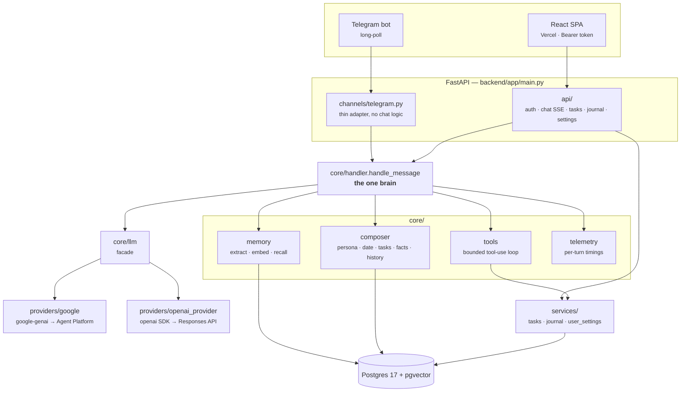
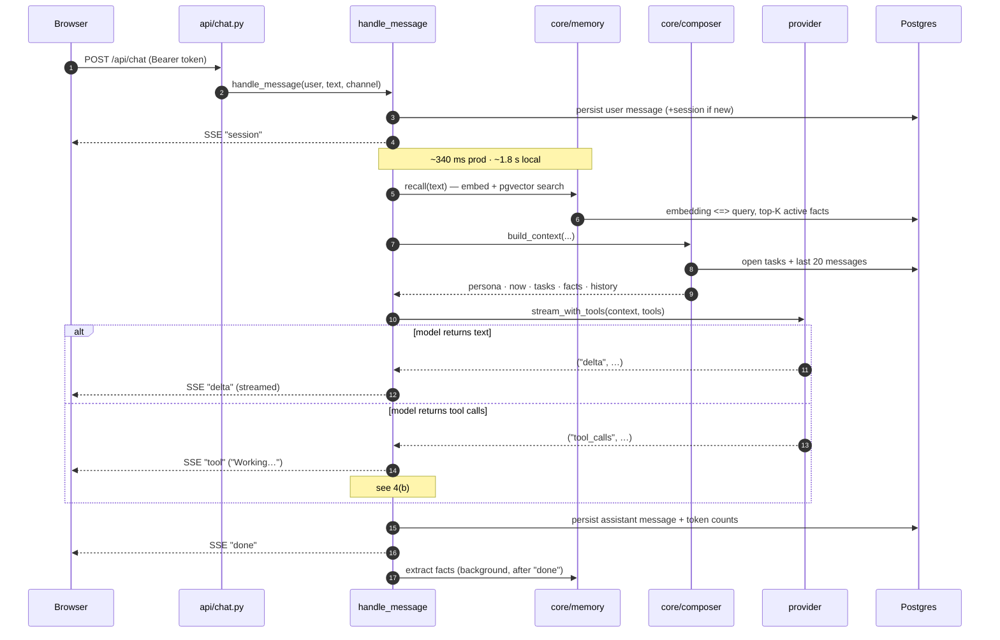
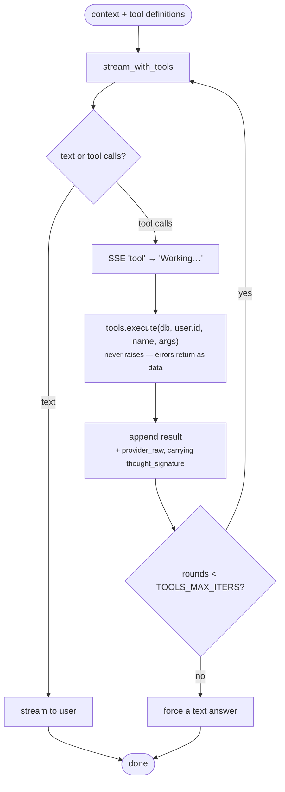
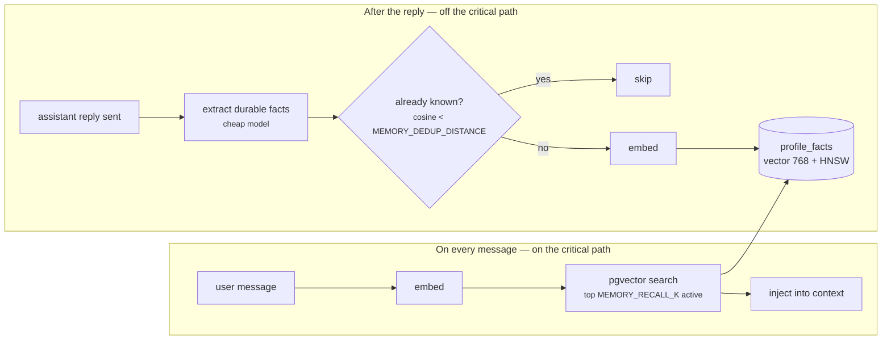
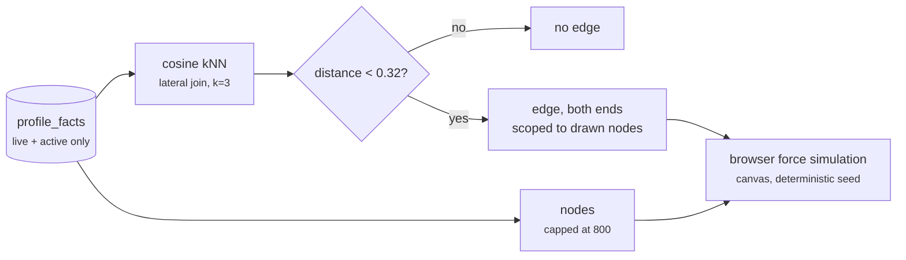
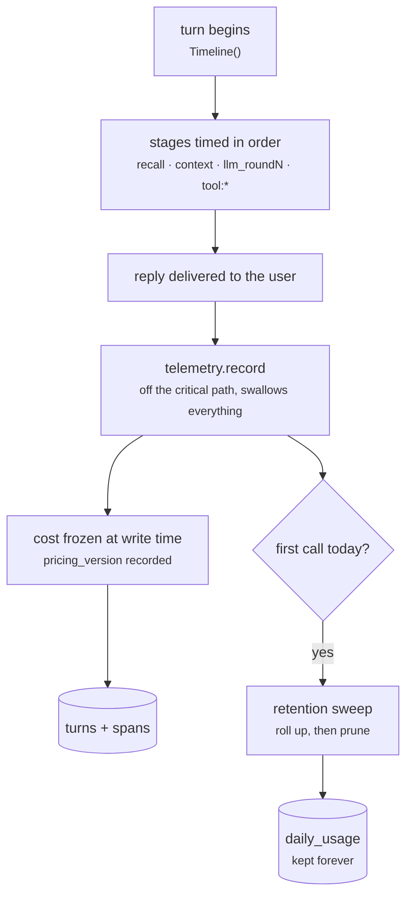
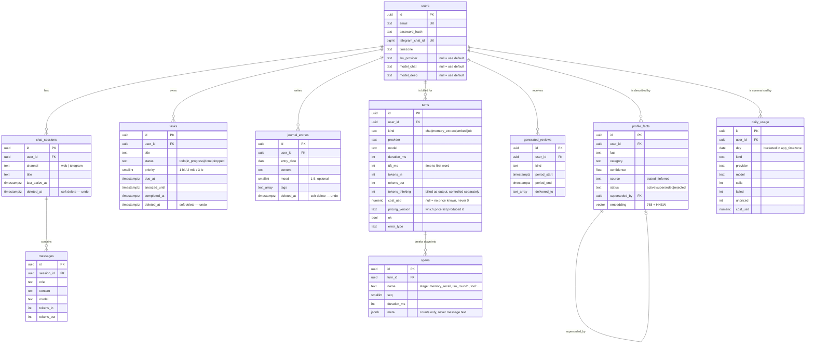

# ARCHITECTURE.md — aceroai

> **This file answers one question: how does the system work?**
> It describes only what is **built and running**. It holds no status and no plans —
> those live in [`ROADMAP.md`](ROADMAP.md), so this file cannot drift by being appended to.
>
> *Last verified against the code: 2026-08-16.*

## 1. Overview

aceroai is a **single-user** personal AI assistant: chat, journaling, tasks, and
cross-session memory. One FastAPI backend serves two thin channels — a React SPA and a
Telegram bot — and **all conversational logic lives in one place**
(`core/handler.handle_message`), so both channels get identical behavior.

The model is reached through a **provider layer** (`core/providers/`) in which every
provider uses its **own native SDK** — not an OpenAI-compatibility shim. This is a
correctness requirement, not a preference: Gemini attaches a `thought_signature` to each
function call that must be returned on the following turn, and the OpenAI-compatible
schema has nowhere to carry it. Dropped, **multi-turn tool calls fail** — which is
exactly what this assistant does.

State lives in Postgres 17 + pgvector: conversations, tasks, journal entries, and the
embedded facts that make up long-term memory.

## 2. System context

**The rule that shapes everything:** channels are transport only. A message from the web
and a message from Telegram enter the *same* `handle_message`, so a feature built once
works in both places. `services/` plays the same role for data: the REST API and the
assistant's tools both go through it, so a task created by tapping **Add** and one created
by the assistant are validated identically.

## 3. Directory guide

### Root

| File | Role |
|---|---|
| `AGENTS.md` | Source of truth for stack, conventions, golden rules |
| `CLAUDE.md` | Claude Code entrypoint — defers to AGENTS.md, mandates the OpenSpec flow |
| `README.md` | Short pointer readme |
| `.env.example` | Template documenting every env var (real values live only in `.env`) |
| `.pre-commit-config.yaml` | ruff (`--fix`), ruff-format, gitleaks secret scan |
| `docker-compose.yml` | Local: `db` (pgvector:pg17, loopback-only) |
| `docker-compose.prod.yml` | Production: `caddy` + `api` + `migrate` + `db` |
| `.github/workflows/ci.yml` | CI (lint + tests on Postgres) and CD (build → GHCR → SSH deploy) |
| `.github/prompts/opsx-*.prompt.md` | Copilot slash commands for the OpenSpec stages |
| `.github/skills/openspec-*/SKILL.md` | Agent skills for the OpenSpec stages |
| `openspec/` | `specs/` (capability source of truth) + `changes/` (in-flight + archive) |
| `docs/` | This file · `ROADMAP` · `DEPLOY` · `DEPLOYMENT-EXPLAINED` · `REQUEST-ANATOMY` · `SOUL` · `UI-AUDIT` |

### Backend (`backend/`)

| Path | Role |
|---|---|
| `app/main.py` | FastAPI app: CORS, router includes, `/health`, lifespan (Telegram poller), domain-error handlers |
| `app/config.py` | `Settings(BaseSettings)` — every runtime knob; `MODEL_CATALOG`; provider-credential checks |
| `app/core/handler.py` | **`handle_message`** — the one brain: persist, recall, compose, stream, tool-loop, persist, telemetry |
| `app/core/composer.py` | Builds context: persona + current date/time + open tasks + recalled facts + history |
| `app/core/llm.py` | Facade over the providers (`stream_with_tools`, `complete`, `embed`) + shared retry/backoff |
| `app/core/providers/base.py` | The provider contract + the error taxonomy |
| `app/core/providers/google.py` | Native `google-genai` → Agent Platform (Vertex) via ADC; `thought_signature` round-trip |
| `app/core/providers/openai_provider.py` | Native `openai` SDK on the **Responses** API; reasoning round-trip; adapts to per-model parameter differences |
| `app/core/tools.py` | Assistant tool definitions + fault-tolerant dispatch |
| `app/core/memory.py` | Extract facts → embed → store (pgvector) → semantic recall, time-bounded |
| `app/core/telemetry.py` | `Timeline` — per-turn stage timings, token estimates, context description |
| `app/core/security.py` | bcrypt hash/verify + JWT create/decode (HS256, 30-day) |
| `app/services/tasks.py` | Task rules incl. urgency ordering and duplicate refusal |
| `app/services/journal.py` | Journal entry rules |
| `app/services/user_settings.py` | Resolve provider/model (user value → configured default); settings payload |
| `app/services/errors.py` | Domain errors mapped to HTTP status in `main.py` |
| `app/api/deps.py` | `get_current_user` — Bearer header (or cookie) → user |
| `app/api/auth.py` | `POST /api/auth/login` · `/logout` · `GET /api/auth/me` |
| `app/api/chat.py` | `POST /api/chat` (SSE) · session list · history · delete session |
| `app/api/tasks.py` | `/api/tasks` CRUD + `/{id}/complete` |
| `app/api/journal.py` | `/api/journal` CRUD |
| `app/api/settings.py` | `GET/PATCH /api/settings` |
| `app/api/schemas.py` | Pydantic request/response models |
| `app/channels/telegram.py` | Telegram long-poll adapter → `handle_message` |
| `app/db/models.py` | The 7 ORM tables (typed `Mapped[]`) |
| `app/db/session.py` | Engine (`pool_pre_ping`), `SessionLocal`, `Base`, `get_db` |
| `app/jobs/` | **Empty package.** APScheduler is a dependency; no job is implemented yet |
| `app/scripts/create_user.py` | One-time interactive user seeding |
| `app/scripts/verify_llm.py` | Legacy smoke test against the **Gemini Developer API** (`LLM_BASE_URL`/`LLM_API_KEY`) — **not** the provider layer the app uses |
| `alembic/versions/…001_core_tables.py` | `CREATE EXTENSION vector` + the 7 core tables |
| `alembic/versions/…002_fact_embeddings.py` | `profile_facts.embedding vector(768)` + HNSW index |
| `alembic/versions/…003_user_model_prefs.py` | `users.llm_provider` · `model_chat` · `model_deep` |
| `tests/` | 13 modules: auth, chat, memory, telegram, providers, tools loop, services, API, context awareness, prod config, health |

### Frontend (`frontend/`)

| Path | Role |
|---|---|
| `index.html` | SPA shell; no-flash theme script |
| `src/main.tsx` | React entry |
| `src/App.tsx` | Auth gate — `LoginScreen` vs `AppShell`, inside `TooltipProvider` |
| `src/index.css` | Tailwind v4 + shadcn tokens (warm palette, light/dark) + animations |
| `src/lib/api.ts` | All backend calls + the Bearer token header + the SSE reader |
| `src/lib/utils.ts` | `cn()` class-merge helper |
| `src/hooks/useSmoothReveal.ts` | Steady-rate typewriter reveal of streamed text |
| `src/hooks/useTheme.ts` | Light/dark toggle + persistence |
| `src/components/AppShell.tsx` | View switch + all chat state (sessions, streaming, abort) |
| `src/components/Sidebar.tsx` | 4-way nav + session list; theme; sign out; mobile drawer |
| `src/components/TasksView.tsx` · `JournalView.tsx` · `SettingsView.tsx` | The three non-chat screens |
| `src/components/MessageList.tsx` · `MessageBubble.tsx` · `Markdown.tsx` · `ThinkingDots.tsx` | Chat transcript rendering |
| `src/components/Composer.tsx` | Auto-grow input; think-harder toggle; send/stop |
| `src/components/LoginScreen.tsx` | Sign-in card |
| `src/components/ui/` | shadcn primitives: `button`, `tooltip`, `dropdown-menu` |

## 4. Lifecycle walkthroughs

*Current behavior, measured — not a design contract.*

### (a) One chat message

Every stage is timed and logged on one line under logger `aceroai.timing`. Measured
figures live in [`REQUEST-ANATOMY.md`](REQUEST-ANATOMY.md) — that document owns them, and
the numbers above are quoted from it.

**Auth note:** the SPA sends a **JWT bearer token from `localStorage`** in an
`Authorization` header. It is *not* an httpOnly cookie: the frontend (Vercel) and backend
(DuckDNS) are different sites, so browsers block the cross-site cookie as third-party.
The trade-off is deliberate and recorded — a `localStorage` token is readable by
JavaScript, so an XSS bug could exfiltrate it, where an httpOnly cookie could not. It is
accepted for a single-user app; the fix, if this ever goes multi-user, is to serve the UI
and API from **one origin** so a first-party httpOnly cookie works again.

### (b) The tool-use loop

Three guarantees hold this loop safe:

- **Bounded** — capped at `TOOLS_MAX_ITERS` (5), then the model must answer in text.
- **User-scoped by construction** — the model never supplies a user id, and every record
  id it passes is verified to belong to the caller.
- **Fault-tolerant** — `tools.execute` never raises. A bad id, bad arguments, or an
  internal error comes back as a structured result the model can recover from.

Tool *execution* is cheap (7–20 ms — it is a database write). The cost of a tool turn is
the **extra model round**: roughly +1.1–1.3 s.

### (c) Memory

Recall is **best-effort and time-bounded** (`MEMORY_RECALL_TIMEOUT_S`, 4 s). If embedding
stalls, the turn proceeds without recalled facts rather than making the user wait — this
bounds tail latency instead of letting one slow call dominate. Extraction runs *after*
`done`, in its own DB session, swallowing every error, so it can never slow or break a
reply.

**⚠ Embeddings are pinned** (`EMBED_PROVIDER` / `EMBED_MODEL` / `EMBED_DIM`) and do **not**
follow the user's chat-provider choice. Every stored vector came from one model, and
vectors from different models are not comparable — same length, different coordinate
space. Switching would not error; recall would quietly return nonsense. Changing them is
a deliberate re-embed migration of every row.

`EMBED_LOCATION` is a **latency-only** setting: identical vectors in every region
(verified cosine `1.000000`), but the `global` endpoint measured ~12 s per call against
~0.5–2 s for a region. Pick the region nearest the **server** — see
[`REQUEST-ANATOMY.md`](REQUEST-ANATOMY.md).

> **Known limit — regenerating does not retract learned facts.** Extraction runs in the
> background after `done`, so by the time a reply is regenerated, any durable facts it
> contained may already be stored. They are not removed. This is accepted rather than
> overlooked: facts are deduplicated and supersedable, so a stale one is corrected by the
> next contradicting statement rather than persisting as truth. Worth revisiting if
> regeneration ever becomes a common action.

### (d) The knowledge map

The Knowledge page draws stored facts as a graph. Edges are not stored — they are computed
from the same vectors recall already uses, so the map cannot drift out of step with what
the assistant actually knows.

Two numbers here were measured, not chosen: the **0.32** cutoff (a first guess of 0.55
excluded nothing — real facts about one person cluster between 0.13 and 0.48), and the
**800**-node cap, above which the layout stops holding a 60 fps frame budget. Past 80 % of
the cap the interface says so rather than quietly degrading.

Edges are scoped to the drawn nodes at *both* ends. Without that, capping the node list
produces edges pointing at facts that are not on screen.

### (e) Trace capture

Every provider call — including the ones nobody sees — records what it cost and where its
time went. Writing happens **after** the reply, and cannot affect it.

Three properties this shape buys, each learned from a defect:

- **Usage is summed across rounds, not overwritten.** A provider reports a cumulative
  total per *request*; a tool-using turn makes several. One dict served both jobs, so a
  turn that billed 2,500 in / 130 out recorded 1,500 / 90.
- **Background work is attributable.** Only the reply produces a `messages` row, so `kind`
  is what makes the embedding and the fact extractor visible instead of free.
- **A failure in recording can never reach the reply.** `telemetry.record` guarantees this
  at the call site, not inside `persist` — proven by a test that replaces `persist` with a
  function that always raises.

## 5. Data model

Why it is shaped this way:

- **`timestamptz` everywhere** (golden rule 3). Store unambiguous UTC instants; render in
  `users.timezone` at the edge. Naive timestamps rot the moment a DST boundary is crossed.
- **Urgency is computed, never stored** (golden rule 2) — fully derived from `due_at` +
  `priority` at read time. A stored urgency goes stale every minute; a computed one cannot.
- **`Text` + CHECK over Postgres enums** (golden rule 7) — changing an enum needs
  `ALTER TYPE` ceremony; swapping a CHECK is one cheap migration. Same integrity, less
  friction.
- **`profile_facts` supersession** — facts are never updated in place. A new row supersedes
  the old (`status='superseded'`, `superseded_by` → the new id), preserving history with
  `valid_from` timelines. `source` + `confidence` let the composer weigh how firmly to
  assert something; `rejected` records what the user explicitly denied, so it is never
  re-inferred.
- **Deleting is reversible** (migration 004) — `DELETE` stamps `deleted_at` rather than
  removing the row, so the UI can offer Undo. **The exclusion filter lives only in the
  `services/` query builders**, which the REST API, the assistant's tools, and the
  composer's task block all read through. That is deliberate: a query that forgot
  `deleted_at IS NULL` would leak deleted records into the model's context, where the
  assistant would act confidently on something the user believes is gone. Deleting a
  conversation keeps its messages, so a restore returns it intact.
- **`generated_reviews` exists but is unwritten** — the table is ready; no job writes to it
  yet (`app/jobs/` is empty).
- **Traces are three tiers, not one table** — `spans` hold per-stage detail and are pruned
  after 30 days; `turns` hold one row per model call and are pruned after 400; `daily_usage`
  is the rollup and is kept forever. `services/retention.py` sweeps them once a local day,
  and always rolls a day up **before** the turns behind it can be deleted. The Insights
  page reads whichever tier owns a given day, so **pruning never changes a spend figure** —
  only how far back the waterfall and the latency percentiles reach.
- **`turns.cost_usd` is nullable and never zero** — NULL means no price was known for that
  model. A zero would silently understate a total; a gap is visible, counted as `unpriced`,
  and gets fixed. Cost is frozen at write time with the `pricing_version` that produced it,
  so a price change today cannot rewrite last month's spend.
- **Traces record shape, never content** — counts, durations, model names. The prompt and
  the reply already live in `messages`; copying them here would double both the disk
  footprint and the blast radius of a leak.

## 6. Config & secrets

`app/config.py` defines `Settings(BaseSettings)`; pydantic-settings loads `.env` from the
repo root (`".env"` for docker/root, `"../.env"` when running natively from `backend/`)
with `extra="ignore"`. Each lowercase field maps to its UPPERCASE env var.

| Group | Settings that matter |
|---|---|
| **Provider defaults** | `LLM_PROVIDER` · `MODEL_CHAT` · `MODEL_HEAVY` — used when a user has not chosen |
| **Google** | `GOOGLE_CLOUD_PROJECT` · `GOOGLE_CLOUD_LOCATION` — **ADC, no API key** |
| **OpenAI** | `OPENAI_API_KEY` · optional `OPENAI_BASE_URL` |
| **Reasoning** | `REASONING_EFFORT_CHAT` (low) · `REASONING_EFFORT_DEEP` (high) |
| **Memory (pinned)** | `EMBED_PROVIDER` · `EMBED_MODEL` · `EMBED_DIM` · `EMBED_LOCATION` · `MEMORY_RECALL_K` · `MEMORY_RECALL_TIMEOUT_S` · `MEMORY_DEDUP_DISTANCE` |
| **Limits** | `TOOLS_MAX_ITERS` · `CONTEXT_TASKS_LIMIT` · `MAX_INPUT_CHARS` · `LLM_MAX_RETRIES` |
| **Production** | `APP_ENV=prod` · `SOUL_PATH` · `SITE_ADDRESS` · `FRONTEND_ORIGIN` |

**Choosing a provider is a per-user setting, not a config change.** It is stored on
`users` (migration 003) and edited in the Settings screen;
`services/user_settings.resolve()` is the single place that resolves *user value →
configured default*. Because the handler calls it, **Telegram honors the same choice with
no channel code**.

**Credentials never enter the UI.** Google authenticates with Application Default
Credentials — `gcloud auth application-default login` locally, and in production the GCE
VM's own service account through the metadata server (no key file, no secret in `.env`).
Note that the IAM role `roles/aiplatform.user` is **not sufficient on its own**: the VM
also needs the `cloud-platform` **access scope**, which is a separate gate — see
[`DEPLOY.md`](DEPLOY.md).

> **Legacy:** `LLM_BASE_URL` and `LLM_API_KEY` point at the Gemini *Developer* API and are
> read by **nothing except `app/scripts/verify_llm.py`**. They are not the provider swap;
> that mechanism no longer exists. Treat them as dead config for the running app.

**Secrets never leave `.env`**: it is gitignored, gitleaks scans every commit, and scripts
print replies — never keys.

## 7. Development workflow

Every non-trivial feature follows the OpenSpec cycle:

| Stage | Command | Meaning |
|---|---|---|
| Propose | `/opsx:propose` | Write proposal + design + tasks; **human reviews before any code** |
| Apply | `/opsx:apply` | Implement the approved change |
| Archive | `/opsx:archive` | Fold the change into `openspec/specs/` |

Daily commands (from `backend/` unless noted):

| Action | Command |
|---|---|
| DB up (repo root) | `docker compose up db -d` |
| API dev server | `uv run uvicorn app.main:app --reload` |
| Frontend dev (`frontend/`) | `npm run dev` |
| New migration | `uv run alembic revision --autogenerate -m "msg"` |
| Apply migrations | `uv run alembic upgrade head` |
| Tests · lint · format | `uv run pytest` · `uv run ruff check .` · `uv run ruff format .` |

Golden rules recap (full text in [`AGENTS.md`](../AGENTS.md)): one brain; derived values
computed; timestamptz everywhere; schema changes only via new migrations; secrets only in
`.env`; uv not pip; Text+CHECK; OpenSpec before code; small diffs with ruff+pytest after;
**docs and diagrams updated by the change that alters the behavior**; ask when unsure.

---

*Where to go next: [`ROADMAP.md`](ROADMAP.md) for what is planned ·
[`REQUEST-ANATOMY.md`](REQUEST-ANATOMY.md) for measured cost and latency ·
[`DEPLOY.md`](DEPLOY.md) for the production runbook ·
[`UI-AUDIT.md`](UI-AUDIT.md) for the interface's known gaps.*
