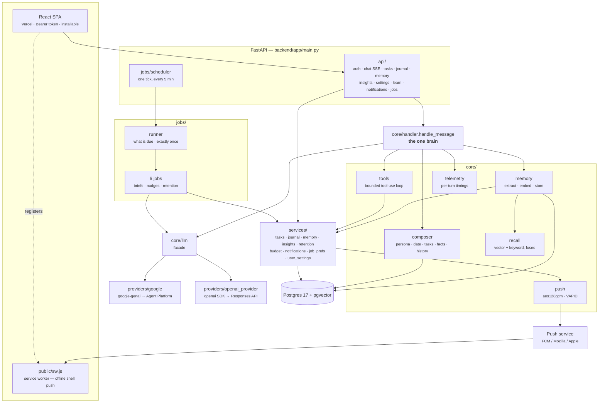
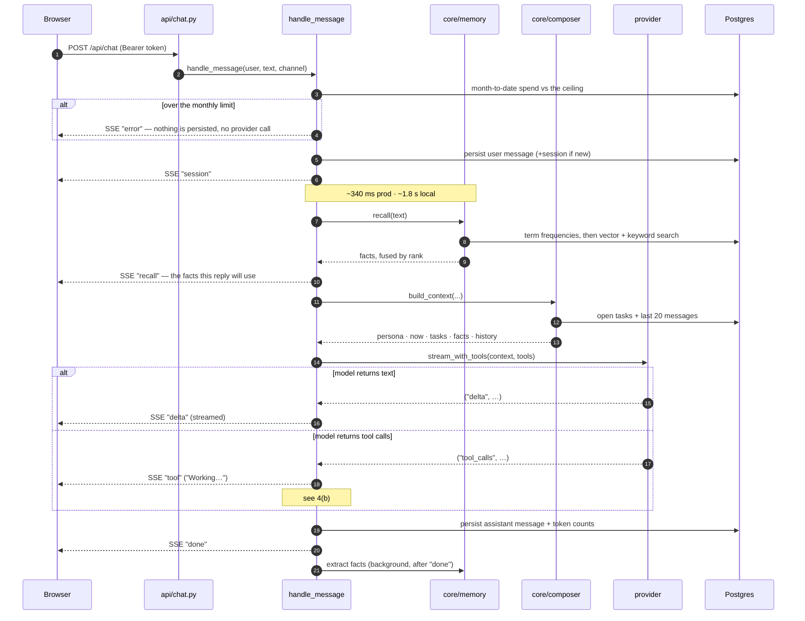
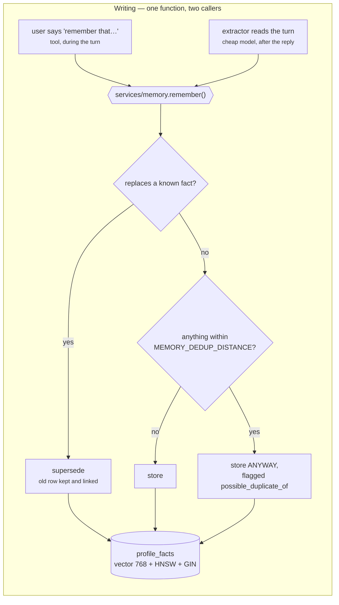
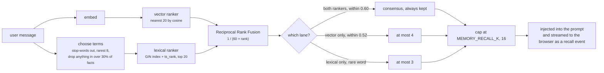
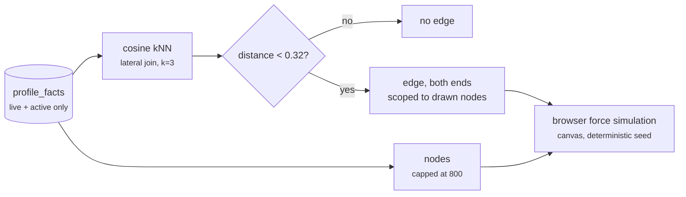
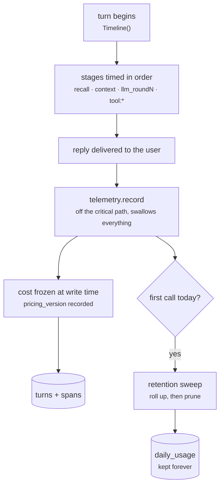
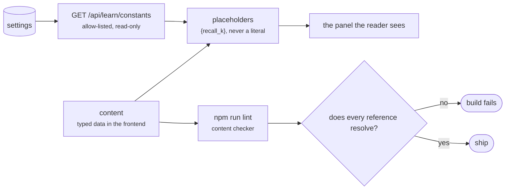
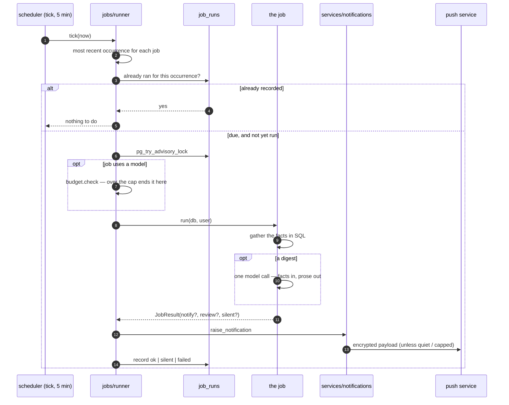
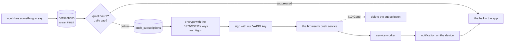

# ARCHITECTURE.md — aceroai

> **This file answers one question: how does the system work?**
> It describes only what is **built and running**. It holds no status and no plans —
> those live in [`ROADMAP.md`](ROADMAP.md), so this file cannot drift by being appended to.
>
> *Last verified against the code: 2026-08-16.*

## 1. Overview

aceroai is a **single-user** personal AI assistant: chat, journaling, tasks, and
cross-session memory. One FastAPI backend serves two thin channels — a React SPA and a
installable web app — and **all conversational logic lives in one place**
(`core/handler.handle_message`), so both channels get identical behavior.

The model is reached through a **provider layer** (`core/providers/`) in which every
provider uses its **own native SDK** — not an OpenAI-compatibility shim. This is a
correctness requirement, not a preference: Gemini attaches a `thought_signature` to each
function call that must be returned on the following turn, and the OpenAI-compatible
schema has nowhere to carry it. Dropped, **multi-turn tool calls fail** — which is
exactly what this assistant does.

State lives in Postgres 17 + pgvector: conversations, tasks, journal entries, and the
embedded facts that make up long-term memory.

## 2. System context

**The rule that shapes everything:** transport is transport only. Every conversational
message enters the *same* `handle_message`, whatever asked for it, so a feature built once
works everywhere. `services/` plays the same role for data: the REST API and the assistant's
tools both go through it, so a task created by tapping **Add** and one created by the
assistant are validated identically.

**The same shape, applied to notifications.** `services/notifications` is the one place
anything Acero wants to say is recorded. Push is a *transport* hanging off it — which is why
a refused permission, a closed laptop or a dead subscription costs the delivery and never the
record.

**Two directions, one system.** Left to right is you asking. `jobs/` is the other direction:
work on a clock that decides whether there is anything worth saying, and reaches you through
the service worker even with the app closed. It has no access to the tool loop — see
[`JOBS.md`](JOBS.md) §3.

> The Telegram channel was retired in migration 011. `handle_message` still takes a
> `channel` argument and `chat_sessions.channel` still permits `'telegram'`, because those
> conversations really happened and the record should not say otherwise.

## 3. Directory guide

### Root

| File | Role |
|---|---|
| `AGENTS.md` | Source of truth for stack, conventions, golden rules |
| `CLAUDE.md` | Claude Code entrypoint — defers to AGENTS.md, mandates the OpenSpec flow |
| `README.md` | Short pointer readme |
| `.env.example` | Template documenting every env var (real values live only in `.env`) |
| `.pre-commit-config.yaml` | ruff (`--fix`), ruff-format, gitleaks secret scan |
| `docker-compose.yml` | Local: `db` (pgvector:pg17, loopback-only) |
| `docker-compose.prod.yml` | Production: `caddy` + `api` + `migrate` + `db` |
| `.github/workflows/ci.yml` | CI (lint + tests on Postgres) and CD (build → GHCR → SSH deploy) |
| `.github/prompts/opsx-*.prompt.md` | Copilot slash commands for the OpenSpec stages |
| `.github/skills/openspec-*/SKILL.md` | Agent skills for the OpenSpec stages |
| `openspec/` | `specs/` (capability source of truth) + `changes/` (in-flight + archive) |
| `docs/` | This file · `ROADMAP` · `DEPLOY` · `DEPLOYMENT-EXPLAINED` · `REQUEST-ANATOMY` · `SOUL` · `UI-AUDIT` |

### Backend (`backend/`)

| Path | Role |
|---|---|
| `app/main.py` | FastAPI app: CORS, router includes, `/health`, lifespan (job scheduler), log redaction, domain-error handlers |
| `app/config.py` | `Settings(BaseSettings)` — every runtime knob; `MODEL_CATALOG`; provider-credential checks |
| `app/core/handler.py` | **`handle_message`** — the one brain: persist, recall, compose, stream, tool-loop, persist, telemetry |
| `app/core/composer.py` | Builds context: persona + current date/time + open tasks + recalled facts + history |
| `app/core/llm.py` | Facade over the providers (`stream_with_tools`, `complete`, `embed`) + shared retry/backoff |
| `app/core/providers/base.py` | The provider contract + the error taxonomy |
| `app/core/providers/google.py` | Native `google-genai` → Agent Platform (Vertex) via ADC; `thought_signature` round-trip |
| `app/core/providers/openai_provider.py` | Native `openai` SDK on the **Responses** API; reasoning round-trip; adapts to per-model parameter differences |
| `app/core/tools/` | One module per domain (`tasks` · `journal` · `memory`), each exporting its schemas **and** handlers; `__init__` assembles `TOOLS` + dispatch |
| `app/core/memory.py` | Extract facts → embed → store through the one writer; orchestrates recall |
| `app/core/recall.py` | Hybrid retrieval: vector ranker + lexical ranker, fused by RRF |
| `app/core/telemetry.py` | `Timeline` — per-turn stage timings; `record()` persists a trace after the reply and guarantees a failure there cannot reach it |
| `app/core/pricing.py` | Dated price list; cost frozen at write time with its `pricing_version` |
| `app/core/security.py` | bcrypt hash/verify + JWT create/decode (HS256, 30-day) |
| `app/services/tasks.py` | Task rules incl. urgency ordering and duplicate refusal |
| `app/services/journal.py` | Journal entry rules |
| `app/services/memory.py` | **The one writer** (`remember` / `correct` / `forget`) + the live/active filter + the kNN graph query |
| `app/services/insights.py` | Trace aggregates, all computed in SQL |
| `app/services/retention.py` | Roll up to `daily_usage`, then prune `spans` and `turns` |
| `app/services/budget.py` | The monthly spend ceiling, checked before each turn |
| `app/services/user_settings.py` | Resolve provider/model (user value → configured default); settings payload |
| `app/services/errors.py` | Domain errors mapped to HTTP status in `main.py` |
| `app/api/deps.py` | `get_current_user` — Bearer header (or cookie) → user |
| `app/api/auth.py` | `POST /api/auth/login` · `/logout` · `GET /api/auth/me` |
| `app/api/chat.py` | `POST /api/chat` (SSE) · session list · history · delete session |
| `app/api/tasks.py` | `/api/tasks` CRUD + `/{id}/complete` |
| `app/api/journal.py` | `/api/journal` CRUD · `briefings` list/delete/restore |
| `app/api/settings.py` | `GET/PATCH /api/settings` + `GET /api/settings/budget` |
| `app/api/memory.py` | Facts list/search/detail/edit/confirm/forget/restore/not-duplicate · graph · stats |
| `app/api/learn.py` | The tuning values the Learn section quotes. Read-only, derived from `settings`, allow-listed |
| `app/api/insights.py` | `overview` · `turns` · `turns/{id}` · `vitals` — read-only |
| `app/api/schemas.py` | Pydantic request/response models |
| `app/jobs/` | Recurring work: `registry` (what a job is), `runner` (what is due, exactly once), `scheduler` (the tick), plus the seven jobs. See [`JOBS.md`](JOBS.md) |
| `app/core/push.py` | Encrypts and signs a web-push message. No key needed to import it |
| `app/services/notifications.py` | Store-then-deliver, quiet hours, repetition suppression, removal |
| `app/services/vitals.py` | Disk, memory, database size, scheduler heartbeat. A reading it cannot take is `None`, never zero |
| `app/db/models.py` | The 14 ORM tables (typed `Mapped[]`) |
| `app/db/session.py` | Engine (`pool_pre_ping`), `SessionLocal`, `Base`, `get_db` |
| `app/scripts/create_user.py` | One-time interactive user seeding |
| `app/scripts/verify_llm.py` | Legacy smoke test against the **Gemini Developer API** (`LLM_BASE_URL`/`LLM_API_KEY`) — **not** the provider layer the app uses |
| `alembic/versions/…001_core_tables.py` | `CREATE EXTENSION vector` + the 7 core tables |
| `alembic/versions/…002_fact_embeddings.py` | `profile_facts.embedding vector(768)` + HNSW index |
| `alembic/versions/…003_user_model_prefs.py` | `users.llm_provider` · `model_chat` · `model_deep` |
| `alembic/versions/…004…010` | soft delete · memory lifecycle · live-facts HNSW · `turns`+`spans` · `daily_usage` · monthly budget · `possible_duplicate_of` + full-text index |
| `alembic/versions/…009_monthly_budget.py` | `users.monthly_budget_usd` — NULL = no limit |
| `tests/` | auth, chat, memory (+ contradiction), providers, tools loop, traces, usage accounting, pricing, retention, budget, jobs (machinery + content), notifications (+ push), services, API (tasks/journal/settings/memory/insights/notifications), context awareness, soft delete, prod config, docs diagrams, health |

### Frontend (`frontend/`)

| Path | Role |
|---|---|
| `index.html` | SPA shell; no-flash theme script |
| `src/main.tsx` | React entry |
| `src/App.tsx` | Auth gate — `LoginScreen` vs `AppShell`, inside `TooltipProvider` |
| `src/index.css` | Tailwind v4 + shadcn tokens (warm palette, light/dark) + animations |
| `src/lib/api.ts` | All backend calls + the Bearer token header + the SSE reader |
| `src/lib/utils.ts` | `cn()` class-merge helper |
| `src/hooks/useSmoothReveal.ts` | Steady-rate typewriter reveal of streamed text |
| `src/hooks/useTheme.ts` | Light/dark toggle + persistence |
| `src/components/AppShell.tsx` | View switch + all chat state (sessions, streaming, abort) |
| `src/components/Sidebar.tsx` | 4-way nav + session list; theme; sign out; mobile drawer |
| `src/components/TasksView.tsx` · `JournalView.tsx` · `SettingsView.tsx` | The three non-chat screens |
| `src/components/MessageList.tsx` · `MessageBubble.tsx` · `Markdown.tsx` · `ThinkingDots.tsx` | Chat transcript rendering |
| `src/components/Composer.tsx` | Auto-grow input; think-harder toggle; send/stop |
| `src/components/LoginScreen.tsx` | Sign-in card |
| `src/components/ui/` | shadcn primitives: `button`, `tooltip`, `dropdown-menu` |

## 4. Lifecycle walkthroughs

*Current behavior, measured — not a design contract.*

### (a) One chat message

Every stage is timed and logged on one line under logger `aceroai.timing`. Measured
figures live in [`REQUEST-ANATOMY.md`](REQUEST-ANATOMY.md) — that document owns them, and
the numbers above are quoted from it.

**Auth note:** the SPA sends a **JWT bearer token from `localStorage`** in an
`Authorization` header. It is *not* an httpOnly cookie: the frontend (Vercel) and backend
(DuckDNS) are different sites, so browsers block the cross-site cookie as third-party.
The trade-off is deliberate and recorded — a `localStorage` token is readable by
JavaScript, so an XSS bug could exfiltrate it, where an httpOnly cookie could not. It is
accepted for a single-user app; the fix, if this ever goes multi-user, is to serve the UI
and API from **one origin** so a first-party httpOnly cookie works again.

### (b) The tool-use loop

Three guarantees hold this loop safe:

- **Bounded** — capped at `TOOLS_MAX_ITERS` (5), then the model must answer in text.
- **User-scoped by construction** — the model never supplies a user id, and every record
  id it passes is verified to belong to the caller.
- **Fault-tolerant** — `tools.execute` never raises. A bad id, bad arguments, or an
  internal error comes back as a structured result the model can recover from.

Tool *execution* is cheap (7–20 ms — it is a database write). The cost of a tool turn is
the **extra model round**: roughly +1.1–1.3 s.

### (c) Memory

Memory has **exactly one writer**. The assistant's tools and the background extractor both
call `services/memory.remember()`, so validation, the duplicate judgement, supersession and
provenance are implemented once rather than twice with thresholds that drift apart.

**Nothing is discarded.** That last branch used to be a delete, and it is what ate a
certification the user had asked for by name: measured, `AI-901` and `AI-103` sit **0.098**
apart, inside the 0.12 threshold, while two phrasings of the *same* family fact sit
**0.216** apart, outside it. The threshold is wrong in both directions at once, so it
cannot be repaired by moving it. Dropping is the destructive move, so dropping is the one
that needs evidence; a stored near-duplicate is visible on the Knowledge page and
answerable in one click.

The extractor may add and supersede but **never delete**. Superseding preserves what it
replaced; deletion in an unattended loop with nobody watching is neither observed nor
prompted.

Reading is two rankers fused by rank — see **(d) Recall** below.

Recall is **best-effort and time-bounded** (`MEMORY_RECALL_TIMEOUT_S`, 4 s). If embedding
stalls, the turn proceeds without recalled facts rather than making the user wait — this
bounds tail latency instead of letting one slow call dominate. Extraction runs *after*
`done`, in its own DB session, swallowing every error, so it can never slow or break a
reply.

**⚠ Embeddings are pinned** (`EMBED_PROVIDER` / `EMBED_MODEL` / `EMBED_DIM`) and do **not**
follow the user's chat-provider choice. Every stored vector came from one model, and
vectors from different models are not comparable — same length, different coordinate
space. Switching would not error; recall would quietly return nonsense. Changing them is
a deliberate re-embed migration of every row.

`EMBED_LOCATION` is a **latency-only** setting: identical vectors in every region
(verified cosine `1.000000`), but the `global` endpoint measured ~12 s per call against
~0.5–2 s for a region. Pick the region nearest the **server** — see
[`REQUEST-ANATOMY.md`](REQUEST-ANATOMY.md).

> **Known limit — regenerating does not retract learned facts.** Extraction runs in the
> background after `done`, so by the time a reply is regenerated, any durable facts it
> contained may already be stored. They are not removed. This is accepted rather than
> overlooked: facts are deduplicated and supersedable, so a stale one is corrected by the
> next contradicting statement rather than persisting as truth. Worth revisiting if
> regeneration ever becomes a common action.

### (d) Recall: two rankers

Recall used to be one query — the `MEMORY_RECALL_K` nearest facts by cosine distance — and
it returned exactly that many facts on *every* message, including `write a python function
to reverse a list`. That is not a tuning problem. Measured against the real memory:

| query | closest fact |
|---|---|
| `where do I work` | **0.406** (`Narendra works at TCS`) |
| `hello` | 0.419 |
| `explain TCP handshakes` | 0.518 |

Every fact about one person occupies a narrow **0.30-0.58** band, and `hello` scores
*closer* than a genuine match for another query. Distance answers "is this about the same
person?"; it cannot answer "does this answer the question?". No threshold separates
`works at TCS` from `has sisters`, because on that axis they are not separated.

Postgres full-text search fails in the opposite direction — precise where vectors are vague,
blind where vectors see. So both run, and their **positions** are fused:

Scores are **not** averaged: cosine distance runs 0.30-0.58 and `ts_rank` runs 0.00-0.10,
so any weighting silently lets one dominate and needs re-tuning whenever either
distribution moves. RRF discards magnitudes and fuses positions, needing no normalisation.
A fact both rankers found scores ~0.032 against ~0.015 for one — and that cliff,
**agreement**, is the relevance signal distance could not provide.

The vector ranker does not "find" facts, it *ranks* them: `ORDER BY distance LIMIT 20`
returns twenty rows whether or not any relate to the message. So its agreement only counts
while the query sits inside the band where one person's facts actually live, which is why
consensus carries an outer bound of its own. Past it, a fact falls back to the lexical
gate rather than being waved through as agreement that never happened.

Measured effect on the real memory:

| query | before | after |
|---|---|---|
| `remind me about my exam` | 12 | **7** — all three exam facts at ranks 1-2-3 |
| `which certifications do I have` | 12 | **6** |
| `where do I work` | 12 | **8** — `works at TCS` first |
| `when do I go to the gym` | 12 | **5** |
| `hello` | 12 | **4** |
| `write a python function…` | 12 | **0** |

`MEMORY_RECALL_K` stops being a quota and becomes a ceiling.

Three honest limits, recorded so nobody assumes more than is there:

- **`ts_rank` is not BM25.** No inverse document frequency, no term-frequency saturation,
  no length normalisation. Measured, a single-term query gives every match the identical
  score `0.060793` — it is a *filter*, not a ranker. That is fine, because RRF only needs a
  position. Real BM25 starts to matter in the thousands of facts; revisit `pg_search` there.
- **A stray keyword can still land a fact.** English stemming maps `write` in "write a
  python function" onto "Narendra *writes* his own summaries". Bounded at 3 per turn, and
  never presented as agreement.
- **Both rankers degrade on a very long message** — the embedding averages three paragraphs
  into one blurred vector and the keyword set gets diffuse. Fusion does not repair that; it
  just does not make it worse.

Cost, measured against the real table (synthetic rows inserted and rolled back — see
`app/scripts/measure_recall_scale.py`, two runs, reported as a range rather than false
precision):

| facts | **added** by a short message | **added** by a three-paragraph message |
|---|---|---|
| 200 | ~3 ms | ~20 ms |
| 1,000 | ~4 ms | ~33-40 ms |
| 5,000 | ~5 ms | ~46-50 ms |

("Added" excludes the vector search, which was already being paid.) The keyword search
reads 0.0 ms on a short query: the GIN index turns it into a dictionary lookup rather than
a comparison against every fact. Against a 300-500 ms embedding round trip inside a 4 s
recall budget, the second ranker is rounding error even at its worst.

### (e) The knowledge map

The Knowledge page draws stored facts as a graph. Edges are not stored — they are computed
from the same vectors recall already uses, so the map cannot drift out of step with what
the assistant actually knows.

Two numbers here were measured, not chosen: the **0.32** cutoff (a first guess of 0.55
excluded nothing — real facts about one person cluster between 0.13 and 0.48), and the
**800**-node cap, above which the layout stops holding a 60 fps frame budget. Past 80 % of
the cap the interface says so rather than quietly degrading.

Edges are scoped to the drawn nodes at *both* ends. Without that, capping the node list
produces edges pointing at facts that are not on screen.

### (f) Trace capture

Every provider call — including the ones nobody sees — records what it cost and where its
time went. Writing happens **after** the reply, and cannot affect it.

Three properties this shape buys, each learned from a defect:

- **Usage is summed across rounds, not overwritten.** A provider reports a cumulative
  total per *request*; a tool-using turn makes several. One dict served both jobs, so a
  turn that billed 2,500 in / 130 out recorded 1,500 / 90.
- **Background work is attributable.** Only the reply produces a `messages` row, so `kind`
  is what makes the embedding and the fact extractor visible instead of free.
- **A failure in recording can never reach the reply.** `telemetry.record` guarantees this
  at the call site, not inside `persist` — proven by a test that replaces `persist` with a
  function that always raises.

### (g) Explaining itself

The **Learn** section teaches how the system works from inside the product: two
click-through diagrams and a set of concept cards. It holds no user data and writes
nothing.

The interesting part is not the page, it is how it avoids going stale. Two mechanisms:

**Numbers are fetched, never written.** A sentence saying "recall sends at most 16 facts"
is correct on the day and wrong later — not as a risk, as a certainty. It had already
happened: `MEMORY_RECALL_K` moved 12 → 16, and the live server was *still* on 12 because
`.env.example` pinned the old value and every copied `.env` inherited it. The endpoint
surfaced that on its first run.

**References are checked, not trusted.** `scripts/check-learn-content.mjs` runs as part of
`npm run lint` and fails the build if a panel points at a file that no longer exists, uses
a `{placeholder}` the endpoint does not serve, or references an undefined concept. It
cannot check that prose is true — nothing can — but that is not where staleness gets in.

Diagrams here are **hand-built SVG + CSS grid**, not Mermaid. Mermaid is right for a
diagram in a document, which is why `docs/` uses it for all eleven; it is wrong for a
component where every box is a button that opens a panel, must be keyboard-reachable, and
has to reflow at 375 px.

**Adding to it** — content lives in `frontend/src/lib/learn/content.ts`:

- a **concept**: append to `CONCEPTS` with a unique `id` and a `group`
- a **diagram step**: add to `nodes`, give it a `panels[id]` entry, and wire its `edges`
- keep to the budget (one summary line, ≤ 5 bullets, ≤ 1 measured figure) — the checker
  enforces it
- never write a number the system decides; write `{the_setting}` and add it to
  `LearnConstants` if it is not served yet

The rule of thumb: **a change to the system updates this in the same commit**. The tests
catch broken references, not missing ones.

### (h) A scheduled job

The other direction: work that runs on a clock rather than because you asked.

**The scheduler is only a ticker.** `job_runs` is the source of truth about what has run, and
`UNIQUE (job_name, occurrence_key)` is what makes exactly-once a database guarantee rather
than something the runner has to be careful about. An in-memory scheduler would lose the
21:00 summary to a 20:58 deploy and report nothing at all.

⚠ **Measured**: a daily job with a 24-hour catch-up window can never be missed — its
occurrences are 24 hours apart, so one is always inside the window. The registry now refuses
such a window at import; "however late" must be written `catch_up=None`. See
[`JOBS.md`](JOBS.md) §2.

### (i) A notification's journey

**Write the row, then attempt delivery — never the reverse.** The record survives a refused
permission, a closed laptop, a dead subscription and a swipe on a lockscreen. A failed push
is recorded against the *device*, and the job that raised it is still a success: a phone in a
drawer must not make working software look broken.

The payload is encrypted with keys the **browser** generated, so the push service relays
something it cannot read. It is capped at ~4 KB, which is why it is a pointer — the substance
stays in the app. Full detail in [`NOTIFICATIONS.md`](NOTIFICATIONS.md).

## 5. Data model

```mermaid
erDiagram
    users ||--o{ chat_sessions : has
    users ||--o{ tasks : owns
    users ||--o{ journal_entries : writes
    users ||--o{ profile_facts : "is described by"
    users ||--o{ generated_reviews : receives
    users ||--o{ turns : "is billed for"
    users ||--o{ daily_usage : "is summarised by"
    users ||--o{ notifications : "is told"
    users ||--o{ push_subscriptions : "is reachable at"
    users ||--o{ user_job_prefs : configures
    chat_sessions ||--o{ messages : contains
    profile_facts ||--o| profile_facts : "superseded_by"
    profile_facts ||--o| profile_facts : "possible_duplicate_of"
    turns ||--o{ spans : "breaks down into"

    users {
        uuid id PK
        text email UK
        text password_hash
        text timezone
        smallint quiet_hours_start "local hour; == end means off"
        smallint quiet_hours_end
        smallint daily_push_cap
        text llm_provider "null = use default"
        text model_chat "null = use default"
        text model_deep "null = use default"
        numeric monthly_budget_usd "null = no spend limit"
    }
    chat_sessions {
        uuid id PK
        uuid user_id FK
        text channel "web | telegram (historical)"
        text title
        timestamptz last_active_at
        timestamptz deleted_at "soft delete — undo"
    }
    messages {
        uuid id PK
        uuid session_id FK
        text role
        text content
        text model
        int tokens_in
        int tokens_out
    }
    tasks {
        uuid id PK
        uuid user_id FK
        text title
        text status "todo|in_progress|done|dropped"
        smallint priority "1 hi / 2 mid / 3 lo"
        timestamptz due_at
        timestamptz snoozed_until
        timestamptz completed_at
        timestamptz deleted_at "soft delete — undo"
    }
    journal_entries {
        uuid id PK
        uuid user_id FK
        date entry_date
        text content
        smallint mood "1-5, optional"
        text_array tags
        timestamptz deleted_at "soft delete — undo"
    }
    profile_facts {
        uuid id PK
        uuid user_id FK
        text fact
        text category
        float confidence
        text source "stated | inferred"
        text status "active|superseded|rejected"
        uuid superseded_by FK
        uuid possible_duplicate_of FK "kept, not deleted"
        vector embedding "768 + HNSW + GIN(fts)"
    }
    generated_reviews {
        uuid id PK
        uuid user_id FK
        text kind
        timestamptz period_start
        timestamptz period_end
        text_array delivered_to
        timestamptz deleted_at "soft delete; deleting does NOT re-run the job"
    }
    turns {
        uuid id PK
        uuid user_id FK
        text kind "chat|memory_extract|embed|job"
        text provider
        text model
        int duration_ms
        int ttft_ms "time to first word"
        int tokens_in
        int tokens_out
        int tokens_thinking "billed as output, controlled separately"
        numeric cost_usd "null = no price known, never 0"
        text pricing_version "which price list produced it"
        bool ok
        text error_type
    }
    spans {
        uuid id PK
        uuid turn_id FK
        text name "stage: memory_recall, llm_round1, tool:..."
        smallint seq
        int duration_ms
        jsonb meta "counts only, never message text"
    }
    daily_usage {
        uuid id PK
        uuid user_id FK
        date day "bucketed in app_timezone"
        text kind
        text provider
        text model
        int calls
        int failed
        int unpriced
        numeric cost_usd
    }
    job_runs {
        uuid id PK
        text job_name
        text occurrence_key "the scheduled instant, ISO local"
        text status "ok|silent|failed|skipped_*|missed"
        timestamptz started_at
        int duration_ms
        text error_type
        jsonb detail "counts only, never message text"
    }
    notifications {
        uuid id PK
        uuid user_id FK
        text kind
        text title
        text body
        text url "in-app route"
        text tag "same tag replaces on the device"
        timestamptz read_at
        timestamptz pushed_at "null = never reached a device"
        timestamptz deleted_at "soft delete; two readers ignore it on purpose"
    }
    push_subscriptions {
        uuid id PK
        uuid user_id FK
        text endpoint UK
        text p256dh "the BROWSER's key"
        text auth "the BROWSER's key"
        timestamptz last_ok_at
        timestamptz last_error_at
    }
    user_job_prefs {
        uuid user_id PK
        text job_name PK
        boolean enabled "sparse — absent = registry default"
    }
```

Why it is shaped this way:

- **`timestamptz` everywhere** (golden rule 3). Store unambiguous UTC instants; render in
  `users.timezone` at the edge. Naive timestamps rot the moment a DST boundary is crossed.
- **Urgency is computed, never stored** (golden rule 2) — fully derived from `due_at` +
  `priority` at read time. A stored urgency goes stale every minute; a computed one cannot.
- **`Text` + CHECK over Postgres enums** (golden rule 7) — changing an enum needs
  `ALTER TYPE` ceremony; swapping a CHECK is one cheap migration. Same integrity, less
  friction.
- **`profile_facts` supersession** — facts are never updated in place. A new row supersedes
  the old (`status='superseded'`, `superseded_by` → the new id), preserving history with
  `valid_from` timelines. `source` + `confidence` let the composer weigh how firmly to
  assert something; `rejected` records what the user explicitly denied, so it is never
  re-inferred.
- **Deleting is reversible** (migration 004) — `DELETE` stamps `deleted_at` rather than
  removing the row, so the UI can offer Undo. **The exclusion filter lives only in the
  `services/` query builders**, which the REST API, the assistant's tools, and the
  composer's task block all read through. That is deliberate: a query that forgot
  `deleted_at IS NULL` would leak deleted records into the model's context, where the
  assistant would act confidently on something the user believes is gone. Deleting a
  conversation keeps its messages, so a restore returns it intact.
- **`generated_reviews` is written by the two digest jobs** (migration 011) — it held no
  rows between migration 001 and that change. `job_runs` has **no `user_id`**: a job is a
  property of the deployment, not of a person, and the single-user assumption lives in the
  runner rather than in the schema
  yet (`app/jobs/` is empty).
- **Traces are three tiers, not one table** — `spans` hold per-stage detail and are pruned
  after 30 days; `turns` hold one row per model call and are pruned after 400; `daily_usage`
  is the rollup and is kept forever. `services/retention.py` sweeps them once a local day,
  and always rolls a day up **before** the turns behind it can be deleted. The Insights
  page reads whichever tier owns a given day, so **pruning never changes a spend figure** —
  only how far back the waterfall and the latency percentiles reach.
- **`turns.cost_usd` is nullable and never zero** — NULL means no price was known for that
  model. A zero would silently understate a total; a gap is visible, counted as `unpriced`,
  and gets fixed. Cost is frozen at write time with the `pricing_version` that produced it,
  so a price change today cannot rewrite last month's spend.
- **Traces record shape, never content** — counts, durations, model names. The prompt and
  the reply already live in `messages`; copying them here would double both the disk
  footprint and the blast radius of a leak.

## 6. Config & secrets

`app/config.py` defines `Settings(BaseSettings)`; pydantic-settings loads `.env` from the
repo root (`".env"` for docker/root, `"../.env"` when running natively from `backend/`)
with `extra="ignore"`. Each lowercase field maps to its UPPERCASE env var.

| Group | Settings that matter |
|---|---|
| **Provider defaults** | `LLM_PROVIDER` · `MODEL_CHAT` · `MODEL_HEAVY` — used when a user has not chosen |
| **Google** | `GOOGLE_CLOUD_PROJECT` · `GOOGLE_CLOUD_LOCATION` — **ADC, no API key** |
| **OpenAI** | `OPENAI_API_KEY` · optional `OPENAI_BASE_URL` |
| **Reasoning** | `REASONING_EFFORT_CHAT` (low) · `REASONING_EFFORT_DEEP` (high) |
| **Memory (pinned)** | `EMBED_PROVIDER` · `EMBED_MODEL` · `EMBED_DIM` · `EMBED_LOCATION` · `MEMORY_RECALL_K` · `MEMORY_RECALL_TIMEOUT_S` · `MEMORY_DEDUP_DISTANCE` |
| **Limits** | `TOOLS_MAX_ITERS` · `CONTEXT_TASKS_LIMIT` · `MAX_INPUT_CHARS` · `LLM_MAX_RETRIES` |
| **Production** | `APP_ENV=prod` · `SOUL_PATH` · `SITE_ADDRESS` · `FRONTEND_ORIGIN` |

**Choosing a provider is a per-user setting, not a config change.** It is stored on
`users` (migration 003) and edited in the Settings screen;
`services/user_settings.resolve()` is the single place that resolves *user value →
configured default*. Because the handler calls it, **every caller honors the same choice with
no channel code**.

**Credentials never enter the UI.** Google authenticates with Application Default
Credentials — `gcloud auth application-default login` locally, and in production the GCE
VM's own service account through the metadata server (no key file, no secret in `.env`).
Note that the IAM role `roles/aiplatform.user` is **not sufficient on its own**: the VM
also needs the `cloud-platform` **access scope**, which is a separate gate — see
[`DEPLOY.md`](DEPLOY.md).

> **Legacy:** `LLM_BASE_URL` and `LLM_API_KEY` point at the Gemini *Developer* API and are
> read by **nothing except `app/scripts/verify_llm.py`**. They are not the provider swap;
> that mechanism no longer exists. Treat them as dead config for the running app.

**Secrets never leave `.env`**: it is gitignored, gitleaks scans every commit, and scripts
print replies — never keys.

## 7. Development workflow

Every non-trivial feature follows the OpenSpec cycle:

| Stage | Command | Meaning |
|---|---|---|
| Propose | `/opsx:propose` | Write proposal + design + tasks; **human reviews before any code** |
| Apply | `/opsx:apply` | Implement the approved change |
| Archive | `/opsx:archive` | Fold the change into `openspec/specs/` |

Daily commands (from `backend/` unless noted):

| Action | Command |
|---|---|
| DB up (repo root) | `docker compose up db -d` |
| API dev server | `uv run uvicorn app.main:app --reload` |
| Frontend dev (`frontend/`) | `npm run dev` |
| New migration | `uv run alembic revision --autogenerate -m "msg"` |
| Apply migrations | `uv run alembic upgrade head` |
| Tests · lint · format | `uv run pytest` · `uv run ruff check .` · `uv run ruff format .` |

Golden rules recap (full text in [`AGENTS.md`](../AGENTS.md)): one brain; derived values
computed; timestamptz everywhere; schema changes only via new migrations; secrets only in
`.env`; uv not pip; Text+CHECK; OpenSpec before code; small diffs with ruff+pytest after;
**docs and diagrams updated by the change that alters the behavior**; ask when unsure.

---

*Where to go next: [`ROADMAP.md`](ROADMAP.md) for what is planned ·
[`REQUEST-ANATOMY.md`](REQUEST-ANATOMY.md) for measured cost and latency ·
[`DEPLOY.md`](DEPLOY.md) for the production runbook ·
[`UI-AUDIT.md`](UI-AUDIT.md) for the interface's known gaps.*
