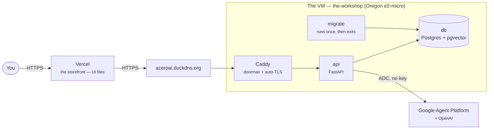
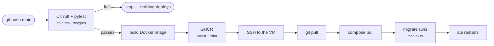

# DEPLOYMENT-EXPLAINED.md — how the whole thing works

A plain-English tour of the aceroai deployment, from the VM outward. For the
step-by-step commands, see [`DEPLOY.md`](DEPLOY.md); this file explains the *why*.

## The big picture
Think of it as **two buildings connected by a secure phone line**:
- **Vercel** = the *storefront* — the UI your browser loads. Just files, globally fast, free.
- **The VM** = the *workshop* — does the real work (login, database, calling Gemini).

## 1. The VM (e2-micro) — a computer that never sleeps
A small computer rented in Google's Oregon data center, running 24/7. Unlike a
laptop, it's always on — so the scheduled jobs (briefings, nudges, retention) run any
time. 1 GB RAM is tiny but fine, because the heavy AI thinking happens on Google's
servers, not ours. Our server is fast "glue."

## 2. Swap — a memory safety cushion
RAM is the desk where running programs work; 1 GB is a small desk. **Swap** is a
2 GB file on disk used as "overflow desk space" when RAM fills up — slower, but it
stops the server crashing during a spike.

## 3. Docker & the containers — sealed, identical boxes
**Docker** packs an app plus everything it needs into a **container** — a sealed
box that runs the same on any machine. We run four:

| Container | Its job |
|---|---|
| **db** | Postgres + pgvector — stores users, chats, and memory facts (with embeddings) |
| **migrate** | Runs once to build/update the database tables, then exits |
| **api** | The FastAPI backend — auth, chat, memory, tasks, journal, settings, notifications, **and the job scheduler** |
| **caddy** | The doorman that handles the internet + HTTPS |

They sit on a **private internal network** and talk by name (`caddy → api:8000 →
db:5432`). Only **caddy** is exposed to the internet; db and api are hidden inside.

## 4. Static IP — the server's permanent street address
Every machine on the internet has an **IP** (ours: `136.117.137.254`). The default
one can change; we **reserved** it so it's permanent, because our domain name points
at that exact number. Google charges ~$3.65/mo for it because IPv4 addresses are
globally scarce, so since 2024 they rent each public one.

## 5. DuckDNS & DNS — turning a number into a name
Computers use IPs; humans use names. **DNS** is the internet's phonebook that maps a
name → an IP. We needed a **name** (`aceroai.duckdns.org`) because HTTPS certificates
are issued to names (not bare IPs) and names are stable + human-friendly. **DuckDNS**
is a free service that gave us a subdomain pointing at our IP.

## 6. Caddy, HTTPS & TLS — the doorman that encrypts everything
- **api** listens on port 8000 *inside* the VM; we never expose it directly.
- **Caddy** sits in front on ports 80/443 (the web's standard ports). It's a
  **reverse proxy** — it takes all web traffic and forwards it to `api:8000`.
- **HTTPS/TLS** is the 🔒 padlock; it encrypts traffic so no one in between can read
  it, and it requires a **certificate** proving you own the domain.
- Caddy automatically gets a **free Let's Encrypt certificate** (via the ACME
  protocol — it proves control of the domain, e.g. the `tls-alpn-01` challenge you
  saw in the logs) and auto-renews it forever.
- HTTPS is mandatory because browsers block an HTTPS page from calling an
  unencrypted backend, and secure login cookies require HTTPS.

## 7. Secrets (`.env`)
Secrets (DB password, JWT signing secret, OpenAI key) live in a `.env` file **on the
server only** — never in the code or GitHub. The app reads it at startup; `chmod 600`
locks it to your user.

**Google needs no key at all.** The VM has its own identity (a *service account*),
and Google hands the app short-lived credentials automatically through the metadata
server — nothing to store, nothing to leak, nothing to rotate. Two separate
permissions must both be granted: the IAM **role** (`roles/aiplatform.user`) *and*
the VM's **access scope** (`cloud-platform`). Having only the first still fails.

## 8. Migrations (alembic)
The database needs an exact structure (users, messages, `profile_facts` with the
vector column). **Migrations** are versioned scripts that build it. The **migrate**
container runs them once on deploy (`001 core tables`, `002 fact embeddings`,
`003 user model prefs`), then exits; the api waits for it so it never runs against a
half-built database.

## 9. Vercel & the frontend
The frontend is **static files** (HTML/JS) — no server logic. Vercel hosts static
sites free, on a global CDN, with automatic HTTPS. We set `VITE_API_URL` so the UI
knows where to send requests. Keeping frontend and backend separate makes the UI
globally fast and independently deployable.

## 10. CORS & why login uses a token, not a cookie
Because the frontend (`…vercel.app`) and backend (`…duckdns.org`) are different
domains:
- **CORS**: a browser won't let a page call a different domain's API unless that API
  explicitly allows the origin — that's `FRONTEND_ORIGIN`.
- **The login cookie didn't work.** A cookie travelling between different sites is
  "third-party," and Brave and (increasingly) Chrome **block those by default** — so
  login appeared to succeed and every request after it failed with 401.
- **The fix (shipped):** the backend returns a **JWT** which the browser keeps in
  `localStorage` and sends as an `Authorization: Bearer …` header. Headers aren't
  cookies, so no privacy protection blocks them, and it works in every browser.
- **The honest trade-off:** JavaScript *can* read `localStorage`, so a cross-site
  scripting bug could steal the token — an httpOnly cookie would have been immune.
  Accepted for a single-user app. The real fix, if this ever opens to other people,
  is to serve the UI and the API from **one domain**, which makes the cookie
  first-party again.

## 11. Auto-deploy
Pushing to `main` deploys itself:

The VM logs in to GHCR with the workflow's own **short-lived token**, piped over
SSH — no long-lived password is stored on the box.

## The full journey of one chat message
You type in Vercel → it sends an HTTPS request to `aceroai.duckdns.org/api/chat` →
DNS routes it to the VM's IP → Caddy decrypts and forwards to `api:8000` → FastAPI
checks your token, checks the month's spend against your ceiling, saves the message to
Postgres, recalls your memory (**two searches — meaning and wording — fused**), calls
**your chosen provider** (Gemini or OpenAI — a per-user setting), and streams the reply
back → saved to the DB → back through Caddy → your browser.
Measured end-to-end in production: **~1.9 s**, first word at ~1.35 s.

## What it costs
- **~$3.65/mo** — the static IP. Unavoidable for a public server.
- **AI usage** — Google runs on **Agent Platform (Vertex)**, billed through **Google
  Cloud Billing**, so **Google Cloud credits pay for it**. This distinction matters:
  the Gemini *Developer* API bills a **separate prepaid balance** that Cloud credits
  **cannot** touch — mistaking the two is what once made the assistant look
  rate-limited when it was really unfunded. OpenAI bills its own account.
- **Everything else** (VM, disk, Vercel) — free.

## Known gap: there are no backups
Everything the assistant knows — memory, journal, tasks, chat history — lives on
**one 10 GB disk on one small VM**, with no dump, snapshot, or off-box copy. If that
disk is lost, it is all gone permanently. This is tracked as a standing risk in
[`ROADMAP.md`](ROADMAP.md) and is not yet solved.
