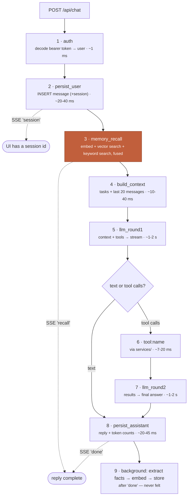

# REQUEST-ANATOMY.md — what one chat message actually costs

Exactly what gets sent, how it is assembled, where the time goes, and what it costs in
tokens. **Every number here was measured on this machine**, not estimated — and you can
reproduce all of them yourself (see [Verify it yourself](#verify-it-yourself)).

---

## 1. What is sent with each message

Your message is never sent alone. `core/composer.build_context()` assembles a stack of
**system blocks** plus recent history, then `core/handler` adds the tool definitions.

| # | Block | Source | Rebuilt each turn? | Typical size |
|---|---|---|---|---|
| 1 | **Persona** | `docs/SOUL.md`, read from disk | yes (file read, ~0 ms) | ~1,000 chars · ~250 tok |
| 2 | **Current date/time** | computed, your timezone | yes | ~70 chars · ~18 tok |
| 3 | **Open tasks** | `tasks` table, urgency-ordered, capped at `CONTEXT_TASKS_LIMIT` (30) | yes (DB read) | ~100 chars/task |
| 4 | **Recalled memory** | `profile_facts` via **two** searches — pgvector similarity *and* Postgres full-text — fused by rank | yes (embedding + 3 queries) | ~90 chars/fact + ~12 tok/id |
| 5 | **History** | last 20 messages of this session (`HISTORY_LIMIT`, a **code constant** in `composer.py` — not an env var) | yes (DB read) | grows with the chat |
| 6 | **Your message** | — | — | — |
| 7 | **Tool definitions** | `core/tools.TOOLS` (10 tools, names + JSON schemas) | every turn | ~1,900 chars · ~470 tok |

**Measured example** (a short message, 9 facts recalled, 3 open tasks, new session):

```
ctx_msgs=5  ctx_chars=2809  ctx_approx_tokens=702      ← our own estimate of blocks 1-6
tokens_in=1259  tokens_out=39                          ← what Gemini actually billed
```

> The gap (702 estimated vs 1,259 billed) is mostly the **tool definitions**, which are
> sent as structured schemas outside the message text, plus tokenizer differences. The
> provider's `tokens_in`/`tokens_out` are the authoritative billing numbers; our
> `ctx_*` figures exist to show *which block* is costing you.

**What is NOT sent:** other conversations, tasks belonging to anyone else, your `.env`,
raw ids beyond task ids, or any provider credentials.

---

## 2. The pipeline, step by step



**Stage 3 is highlighted because it dominates**: ~1.7–3 s locally, ~340 ms in production.
Everything our own code does — auth, both DB writes, context assembly — totals under
100 ms.

**Streaming matters:** you see the first word at `first_token`, not at `total`. The
reply keeps arriving after that.

---

## 3. Measured latency (this machine, 2026-08-16)

Short message, 9 facts recalled, no tool call. Times in ms.

| Stage | Gemini `3.5-flash` | OpenAI `gpt-5.1` |
|---|---|---|
| persist_user | 21–30 | 19–41 |
| **memory_recall** | **1,775–1,825** | **1,713–1,715** |
| build_context | 8–13 | 10–14 |
| llm_round1 | 1,048–1,056 | 1,736–1,804 |
| persist_assistant | 30–42 | 40–45 |
| **first token** | **~2,870** | **~3,500** |
| **total** | **~2,910–2,950** | **~3,542–3,591** |

First request after a restart is slower (~5.2 s Gemini / ~8.0 s OpenAI) — cold
connections. A tool turn adds one more model round: ~+1.0–1.4 s plus ~7–20 ms for the
tool itself.

**Reading it:** the model is ~1–1.8 s. Our own code (DB, assembly) is **under 100 ms
total** — it is not the bottleneck. Everything else is network.

### ⚠ The big find: embeddings were costing 12 seconds

Before this instrumentation existed, every message took **~14 s**. The logs showed why:

```
turn total=14629ms  memory_recall=12886ms  llm_round1=1669ms  build_context=16ms
recall embed=12721ms  pgvector=23ms          ← the embedding call, not the database
```

**Cause:** embeddings were served from Vertex's `global` endpoint. Measured with
realistic gaps between calls (i.e. real conversation), `global` took **~12 s every
time**, while `us-central1` took **~0.5–2 s** for the *same model and dimensions*.

**Fix:** `EMBED_LOCATION=us-central1` (a separate regional client just for embeddings).
Before switching, the vectors were compared across regions: **cosine similarity
1.000000** — identical, so stored memory stays valid. Result: **~14 s → ~2.9 s.**

A `MEMORY_RECALL_TIMEOUT_S` (4 s) now caps this stage: if embedding stalls, you get an
answer without recalled facts instead of a 12-second wait. Recall was always
best-effort; now its cost is bounded.

---

## 4. Token cost per turn

From the same measured turns:

| | Gemini turn (no tool) | Gemini turn (with 1 tool round) |
|---|---|---|
| `tokens_in` | 1,259 | 1,530 |
| `tokens_out` | 39 | 97 |

**What drives `tokens_in`:** the fixed floor is persona + date + tool schemas
(~600–700 tokens) — paid on *every* message. On top of that: ~25 tokens per recalled
fact, ~25 per open task, and the whole visible history (which grows until it hits the
20-message window).

**A tool turn costs roughly double**, because the entire context is re-sent for round 2
along with the tool result.

**Also billed, off the reply path:** memory extraction after `done` (one `complete()`
call plus an embedding per new fact), and one embedding per message for recall.

Measured over 128 real calls: background work is **4.4 % of spend but a third of all
calls** — 47 embeddings and 31 extractions against 50 chat turns. It used to be billed and
counted nowhere.

### The extraction prompt: a line that grew forever, made flat

The fact extractor was shown **every** stored fact on every message, so that it would not
re-learn something already known. That block grew with the memory itself, forever.

Measured on the real database, twice, three days apart:

| | Facts | `known_block` |
|---|---|---|
| **Before** (2026-08-16) | 11 | **144 tok/message** |
| **Before** (2026-08-19) | 22 | **275 tok/message** |
| Projected, unbounded | 100 | 1,253 tok/message |
| | 500 | 6,267 tok/message |
| **After** (Decision 8) | any | **~150 tok/message, constant** |

The fix reuses the facts `memory_recall` already fetched for this turn, capped at
`MEMORY_RECALL_K` (12), instead of loading them all again. Those are the facts most
semantically similar to what was just said — which are exactly the ones a duplicate would
collide with — so the guard against re-learning gets *stronger* relative to its cost.

**Read this honestly: it saved nothing on the day it shipped.** At 22 facts the cap is
barely reached. Its whole value is the shape of the line, and the two "before" rows show
the growth is real rather than theoretical — the cost nearly doubled in three days of
ordinary use.

---

## 5. Verify it yourself

Every turn logs one line (logger `aceroai.timing`). Watch the backend console, or:

```powershell
# from backend/
$env:TELEGRAM_BOT_TOKEN=""; uv run uvicorn app.main:app --reload
```

Send a message and compare against your stopwatch:

```
turn total=2913ms persist_user=30ms memory_recall=1789ms build_context=8ms
  first_token=2862ms llm_round1=1056ms persist_assistant=30ms
  provider=google model=gemini-3.5-flash effort=low facts=9
  ctx_msgs=5 ctx_chars=2795 ctx_approx_tokens=698 rounds=1 tokens_in=1530 tokens_out=97
```

- **Stopwatch from pressing Enter to the first word appearing** ≈ `first_token`.
- **Stopwatch to the reply finishing** ≈ `total` **plus** network/render time between
  your browser and the server (a few ms locally, ~100–300 ms against the live VM).
- `recall embed=… search=… facts=N (both=… vector=… lexical=…)` is logged per turn,
  splitting the network call from the database work **and** naming which ranker found
  each fact. `facts=8 (both=4 vector=4 lexical=0)` and `facts=8 (both=0 vector=8)` are
  very different turns, and the second is the one worth looking at.
- Per-block sizes: set the app logger to `DEBUG` to also print each block's chars/tokens.

Expect variance of a few hundred ms between identical requests — that is the provider,
not the app.

---

### Production numbers (Oregon VM, measured 2026-08-16)

The deployed backend is **faster than local dev**, because the VM sits close to the
embedding region while the laptop is a continent away:

| | Laptop (India) | **Production VM (Oregon)** |
|---|---|---|
| embedding (`us-central1`) | ~1,775 ms | **~338–364 ms** |
| fact search (both rankers) | ~15–30 ms | **~6–12 ms** |
| plain turn, total | ~2,910 ms | **~1,909 ms** |
| plain turn, first token | ~2,870 ms | **~1,350 ms** |
| tool turn (1 tool, 2 rounds) | — | ~2,668 ms |
| tool turn (2 parallel tools) | — | ~3,520 ms |

Observations from the live logs:
- **A tool turn costs ~+1.1–1.3 s** — and that is the *extra model round*, not the tool:
  `tool:create_task=10ms`, `tool:complete_task=12ms`. Tools are cheap; model calls are not.
- **Parallel tool calls work**: one turn logged `tool:create_task=10ms tool:create_task=7ms`.
- **Cold start is real but settles**: the first embedding after a restart took 2,143 ms,
  then 338 ms; `persist_user` went 224 ms → 8 ms as the DB pool warmed.
- `tokens_in` drifted 1,021 → 1,371 within a session as history and recalled facts grew.

### Region matters — pick the one nearest the *server*

Same model, same 768 dims, measured from a laptop in India (6 s gaps between calls):

| `EMBED_LOCATION` | latency |
|---|---|
| `global` | ~12,000 ms |
| `us-central1` (Iowa) | ~1,771 ms |
| `asia-south1` (Mumbai) | **~486 ms** |
| `asia-southeast1` (Singapore) | ~459 ms |

Vectors identical in every region (cosine **1.000000** against `us-central1`).

So the remaining latency after the `global` fix really was **distance**. But the
distance that counts is **server → region**, not user → region:

- **Local dev in India** → `EMBED_LOCATION=asia-south1` (~486 ms)
- **Production VM in `us-west1` (Oregon)** → `EMBED_LOCATION=us-central1`

Setting Mumbai on the Oregon VM would make production *slower*. Hence it is per-environment
config, defaulting to `us-central1` (which suits the deployed server).

## 5b. What the second ranker cost (measured 2026-08-20)

Recall became two searches instead of one. The question that matters is whether the added
database work is visible next to the embedding round trip. It is not.

Measured on the real `profile_facts` table, with synthetic rows inserted and rolled back.
Re-derive it any time with `uv run python -m app.scripts.measure_recall_scale`. Two runs,
reported as a range rather than false precision:

| facts | doc-frequency probe | keyword search | vector search | **added** |
|---|---|---|---|---|
| 200, short message | ~3 ms | 0.0 ms | ~10 ms | **~3 ms** |
| 1,000, short message | ~4 ms | 0.0 ms | ~14 ms | **~4 ms** |
| 5,000, short message | ~5 ms | 0.0 ms | ~10 ms | **~5 ms** |
| 1,000, three paragraphs | 19-24 ms | 15 ms | ~15 ms | **~33-40 ms** |
| 5,000, three paragraphs | 26-27 ms | 21-24 ms | ~9 ms | **~46-50 ms** |

(The vector column was already being paid before this change; "added" is the other two.)

Worst case measured is ~50 ms against a 300-500 ms embedding call and a 4,000 ms recall
budget — **just over 1 %**. The keyword search reads 0.0 ms on a short query because the
GIN index turns it into a dictionary lookup rather than a comparison against every fact.

The one real cost risk was measured and designed out: a term present in *every* fact makes
`ts_rank` score every match before sorting, which cost **219 ms at 20k facts**. Not
hypothetical — every fact begins with the user's name by design. Terms appearing in more
than 30 % of facts are dropped before the query is built.

**Prompt size went down, not up.** Recall is now a ceiling rather than a quota: measured on
the real memory, an ordinary question returns 4-8 facts instead of a fixed 12, and a
question about nothing stored returns none at all.

| query | facts before | facts after |
|---|---|---|
| `remind me about my exam` | 12 | 7 |
| `where do I work` | 12 | 8 |
| `hello` | 12 | 4 |
| `write a python function to reverse a list` | 12 | **0** |

At ~25 tokens per recalled fact that is roughly **100-200 tokens saved on a typical turn**,
which more than pays for the ~12 tokens per fact now spent carrying its id — the id being
what lets the assistant correct or forget a fact in one step instead of two.

---

## 6. Where the remaining time goes (honest assessment)

At ~2.9 s, the split is roughly **60 % embedding, 35 % model, <5 % us**.

Options if it needs to be faster, and their costs:
- **Skip recall on trivial messages** ("ok", "thanks") — saves ~1.7 s on those turns.
- **Cache the embedding** of repeated identical messages — narrow benefit.
- **A faster/smaller embedding model** — would invalidate every stored vector, so it
  requires a deliberate re-embed migration (see the pinning note in Settings).
- **Fewer tools or shorter schemas** — cuts the fixed token floor, at the cost of
  capability.

None are done yet; the 5× win from the region fix was the one worth taking first.
